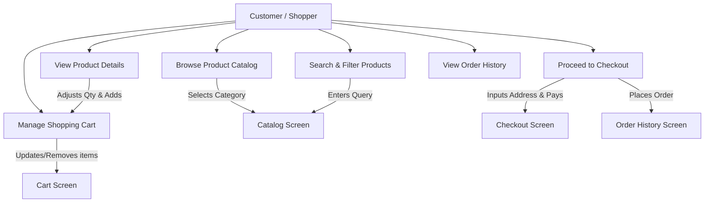
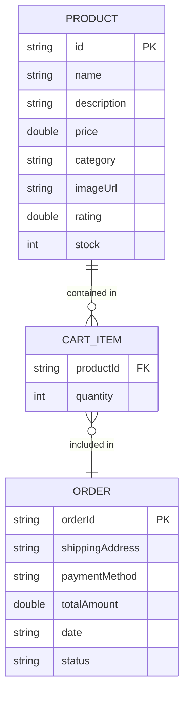

# MTR Boutique - Modern E-Commerce Android Application

## 1. Detailed Description of the Project
**MTR Boutique** is a feature-rich, modern Android e-commerce mobile application developed using Jetpack Compose and Material 3. Designed with a soothing baby blue pastel aesthetic, the application delivers a seamless and intuitive mobile shopping experience. Users can explore curated product catalogs across multiple categories, search for items in real-time, inspect detailed product specifications accompanied by high-resolution imagery, manage their shopping carts with dynamic quantity controls and price calculations in Saudi Riyals (`⃁`), complete simulated checkouts, and review their past order history and status tracking.

---

## 2. Project Scope Statement
### In-Scope
- **Product Discovery**: Browse items by category (Electronics, Fashion, Home & Living, Books) and search products in real-time.
- **Product Details**: View high-resolution product imagery, descriptions, ratings, stock status, and adjust quantities before purchasing.
- **Shopping Cart Management**: Add items, adjust quantities (`+/-`), remove products, and view live subtotal calculations.
- **Checkout & Order Placement**: Input shipping addresses, select payment methods, and confirm orders in Riyals (`⃁`).
- **Order Tracking**: View a chronological history of past orders with status badges ("Processing").
- **UI/UX Design**: Fully responsive Material 3 interface styled with a custom cohesive Baby Blue pastel color palette.

### Out-of-Scope
- Integration with live external payment gateways (e.g., Stripe, Apple Pay, Mada API).
- Cloud database synchronization (backend server); data is managed locally via a reactive Repository and ViewModel pattern.
- Multi-vendor seller management portal and push notification services.

---

##  3. Product Features

### Functional Features
1. **Catalog & Search**: Instant keyword search and category filtering chips.
2. **Product Detail View**: High-resolution image preview, ratings, description, and stock-aware quantity selector.
3. **Shopping Cart**: Real-time item tally, quantity updates, removal, and grand total computation.
4. **Checkout System**: Address form validation and secure order placement.
5. **Order History**: Persistent list of placed orders showing order ID, timestamp, items count, shipping address, and status.

### Non-Functional Features
1. **Performance**: Smooth 60fps rendering utilizing Jetpack Compose declarative UI and Coroutine-backed asynchronous state flows (`StateFlow`).
2. **Usability**: Clean bottom navigation bar with live cart item counter badges and intuitive screen routing.
3. **Maintainability**: Strict separation of concerns adhering to MVVM architecture and Clean Code principles.
4. **Visual Design**: Cohesive baby blue pastel theme (`#90CAF9`, `#E3F2FD`, `#F4F9FC`) providing a modern and relaxing user interface.

---

## 4. Software Development Methodology
The project was developed using an **Agile Iterative Methodology** combined with the **MVVM (Model-View-ViewModel)** architectural design pattern:
- **Planning & Requirements Analysis**: Defining user stories, app workflows, and rubric criteria.
- **Modular Architecture**: Decoupling the codebase into Data Models, Repositories, ViewModels, and Compose UI screens.
- **Incremental Development**: Building and verifying core features iteratively (Catalog -> Detail -> Cart -> Checkout -> Orders).
- **Continuous Testing & Refinement**: Building through Gradle (`BUILD SUCCESSFUL`) and verifying UI fidelity on emulators.

---

## 5. Project Diagrams

### Use-Case Diagram

### Entity-Relationship (ER) Diagram

---

##  6. Tools and Technologies Used
- **Programming Language**: Kotlin 2.0+
- **UI Framework**: Jetpack Compose & Material 3
- **Navigation**: Jetpack Navigation Compose
- **State Management**: AndroidX ViewModel, Kotlin Coroutines, and `StateFlow`
- **Image Loading**: Coil Compose (`io.coil-kt:coil-compose`)
- **Build System**: Android Gradle Plugin (AGP) 9.5.2 & Gradle
- **Development IDE**: Android Studio

---

## 7. Software Testing
- **Unit Testing**: JUnit 4 unit tests verifying ViewModel business logic, state mutations, and repository calculations.
- **Instrumentation & UI Testing**: AndroidX JUnit and Espresso integration tests validating UI component rendering and user interaction flows.
- **Device Verification**: Rigorous testing on Android Emulator (API 37) ensuring edge-to-edge layout compliance, smooth animations, and zero runtime exceptions (`SecurityException` handled via Internet permission, `BUILD SUCCESSFUL`).
